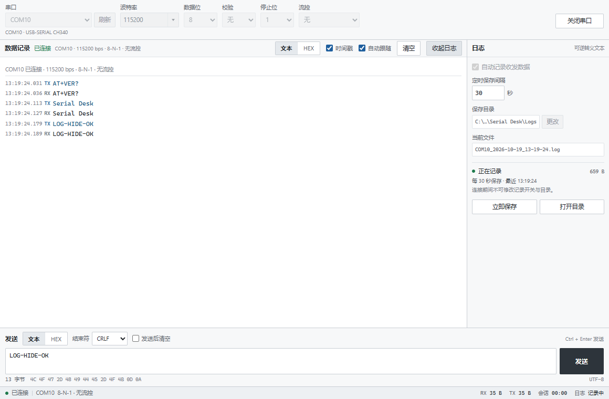
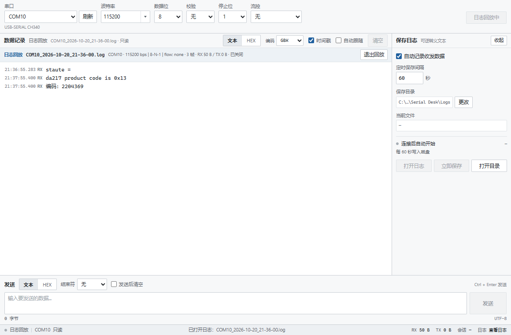

# Serial Desk

一个面向 Windows 的轻量串口调试工具。界面克制、数据路径严谨，重点解决两件事：

- 串口收发必须 **字节准确、可核对、出错必提示**；
- 日志必须 **按用户设定的周期自动保存到磁盘**，并在关闭连接时完整收尾。

同时提供命令行工具 **`sdesk`**：不用打开界面，脚本或 AI 代理就能抓取串口、发送数据，并直接读取同一份会话日志。详见 [docs/CLI.md](docs/CLI.md)。

应用为单文件，GUI 发布版约 **6 MB**，不内置浏览器内核，依赖 Windows 10/11 自带的 WebView2 Runtime。CLI 为独立的 0.8 MB 单文件，不依赖 WebView2。



## 功能

- 串口配置：端口、常用波特率下拉（20 档，也可直接输入自定义值，范围 50–4,000,000 bps）、数据位 5/6/7/8、校验 无/偶/奇、停止位 1/2、流控 无/硬件 RTS-CTS/软件 XON-XOFF。
- 接收/发送同屏显示，文本与 HEX 即时切换。
- 时间戳显示在左侧固定时间栏，不打断设备日志行；超过 1 秒的间隔即使还没收到换行，也会另起时间戳行，避免跨分钟数据共用一个时间戳；支持自动跟随、清空、回到最新。
- 文本显示编码可选 **UTF-8 / GBK**；切换到 HEX 后编码选择自动锁定，原始字节不受影响。
- 严格 HEX 发送：只接受十六进制字符和空白，必须为偶数位，绝不静默忽略无效字符。
- 文本按 UTF-8 发送，结束符可选 无 / CR / LF / CRLF；发送前实时显示字节数与 HEX 预览。
- 实时统计 RX/TX 字节数与帧数；界面数据流带序号校验，出现缺口会明确提示。
- **定时保存日志**：可设 5–3600 秒，自动记录收发双向数据，每个周期落盘；断开或退出时强制收尾。
- 右侧“保存日志”面板可收起/展开；收起后串口收发与日志记录不中断，状态栏仍显示日志状态。
- 可直接打开已保存的 `.log` 进行只读回放，按原始字节、时间戳和方向显示，支持文本/HEX 切换；回放期间不会连接或占用串口。
- 日志采用可逆文本格式：控制字符和非法 UTF-8 字节全部转义，任何原始字节都可还原。
- 串口连接期间锁定端口参数与日志目录，保存间隔可实时调整。
- **命令行（`sdesk`）**：列出串口、后台抓取、发送数据、读取/过滤/跟踪日志；支持 JSONL 输出与稳定退出码，便于脚本和 AI 代理使用。
- 设置自动保存；不离开本机、不联网。

## 快速开始

1. 运行 `SerialDesk.exe`。
2. 选择串口与参数，点击“打开串口”。
3. 终端会显示收发的数据；在下方输入内容，`Ctrl + Enter` 发送。
4. 默认开启日志：连接后立即记录，每 30 秒写入磁盘；可在连接前调整间隔和目录。
5. 未连接串口时，在“保存日志”面板点击“打开日志”，选择 `.log` 即可只读回放；点“退出回放”回到实时界面。

命令行（无需界面）：

```powershell
sdesk ports
sdesk capture --port COM10 --json
sdesk send --port COM10 --data "AT\r\n"
sdesk log tail --latest --lines 30 --json
```

运行环境：Windows 10/11 x64，已安装 Microsoft Edge WebView2 Runtime（Windows 11 默认包含）。`sdesk` 不需要 WebView2。

## 数据严谨性说明

### 串口收发

- 所有串口读写都在 Rust 后端完成，不依赖浏览器串口 API，也不做隐式编码转换。
- 读线程按原始字节接收；日志在推送到界面前写入，界面卡顿不会影响日志。
- 后端为每个界面数据帧附加序号；前端检测到缺口会显示提示，而不是假装数据连续。
- 发送为严格的字节行为：
  - 文本模式：UTF-8 编码 + 明确选择的结束符；孤立代理字符会被拒绝，不会被静默替换。
  - HEX 模式：按输入解析为字节，并做完整合法性校验。
  - 写入串口时统计实际写入字节数；发生部分写入时返回明确错误，日志中只记录实际交给驱动的字节。
- 读超时固定为 12 ms（用于轮询停止标志），写超时单独设为 60 秒，避免大包发送被读超时误截断。
- 同一时间只允许打开一个串口；打开失败会直接显示原因，不会进入“看似连接”的状态。

### 日志

- 文件按连接会话生成：`COM10_2026-10-19_12-02-05.log`。
- 每帧写入磁盘：`时间戳 | 方向 | 字节数 | 可逆转义内容`，收发双向都记录。
- 每 N 秒执行一次 `sync_data`（真正的磁盘同步）；手动“立即保存”、断开串口、关闭窗口时也会立即同步。
- 日志写入失败时会持续显示错误，不会静默继续。
- 关闭窗口、断开串口时会写入结束标记并强制同步。强制结束进程、系统断电或休眠可能最多丢失最后一个保存周期的数据。
- 详细格式与还原方法见 [docs/LOG_FORMAT.md](docs/LOG_FORMAT.md)。

### 终端显示缓冲

终端仅保留最近 8 MB 的显示数据（超出后滚动清理并显示提示），这是为了长时间运行时的内存与流畅度。**日志文件不参与该截断**。如果关闭自动记录，较早的显示内容可能无法恢复。

## 日志回放

未连接串口时，在“保存日志”面板点击“打开日志”，选择保存的 `.log` 即可回放。回放按原始字节显示 RX/TX、时间戳和方向，支持文本/HEX 切换；期间不会打开或占用串口，也不能误触连接。点击“退出回放”恢复打开日志前的终端内容与计数。



## 命令行（`sdesk`）

`sdesk.exe` 与 GUI 共用串口核心、日志记录器和转义规则，但不依赖 Tauri/WebView2。它面向脚本和 AI 代理：stdout 只输出数据，提示与错误写入 stderr，`--json` 输出 JSONL。

```powershell
sdesk ports                                   # 串口列表
sdesk capture --port COM10 --json             # 后台抓取 + 写日志 + JSONL 输出
sdesk send --port COM10 --data "AT\r\n"       # 发给正在运行的 capture
sdesk stop --port COM10                       # 正常收尾
sdesk log tail --latest --lines 30 --json     # 直接读取最新日志
sdesk log show --latest --grep ERROR --json   # 过滤
```

- 能直接读 GUI 写出的日志，也能让 GUI 读 CLI 写出的日志；格式完全一致。
- 实时跟随 GUI 正在写的日志：`sdesk log tail --latest --follow --json`。
- AI 不需要解析转义：每帧 JSON 都同时提供 `text`（可读）和 `hex`（精确字节）。
- `capture` 独占串口，`send` 通过本机回环控制通道写入同一个进程，因此不会出现“串口被占用”。
- 退出码 `0` 成功、`1` 运行错误、`2` 参数错误、`3` 超时或没有匹配数据；便于程序区分“没收到日志”和“工具失败”。
- 完整命令、JSON 字段、控制通道和 AI 工作流见 [docs/CLI.md](docs/CLI.md)。

## 支持范围与硬件提示

- 文本显示支持 **UTF-8 / GBK** 选择（发送仍按 UTF-8 或 HEX）。设备若使用其他编码，请切换到 HEX 查看，避免文本替换符造成误解。
- 校验位支持 无/偶/奇，停止位支持 1/2；当前版本未提供 Mark/Space 校验和 1.5 停止位。
- 打开串口可能改变 DTR/RTS 电平，部分开发板会因此复位；请确认设备连接情况后再打开。
- 本版本聚焦单串口调试与日志，不包含定时发送、快捷指令、Modbus 或网络调试。
- 同一串口同一时间只能被一个进程打开；GUI 连接期间请先断开再运行 `sdesk capture`。`sdesk log` 只读，可以随时使用。
- 本发布版未做代码签名。若 Windows SmartScreen 提示“未知发布者”，请核对 SHA-256 后选择仍要运行。
- 串口工具具有直接操作硬件的能力；请先确认端口和参数再发送数据。

## 默认路径

- 设置：`%APPDATA%\com.serialdesk.app\settings.json`
- 日志：`%USERPROFILE%\Documents\Serial Desk\Logs`
- CLI 会话状态：`%LOCALAPPDATA%\com.serialdesk.app\cli-sessions`

## 发布文件

| 文件 | 大小 | 说明 |
|---|---:|---|
| `release/SerialDesk.exe` | 6,454,784 B（6.16 MiB） | GUI 便携版，双击运行 |
| `release/sdesk.exe` | 817,664 B（0.78 MiB） | 命令行版，无需 WebView2 |
| `release/SerialDesk-1.2.0-win64.zip` | 2,629,954 B（2.51 MiB） | 当前版本压缩包，含两个 EXE、说明、日志格式与 CLI 文档 |
| `release/SerialDesk-1.1.0-win64.zip` | 2,627,735 B（2.51 MiB） | 1.1.0 归档，保留以便回退 |
| `release/SerialDesk-1.0.0-win64.zip` | 2,149,725 B（2.05 MiB） | 1.0.0 归档，保留以便回退 |

SHA-256：

```text
5AE1E25C0EAD76E46610FE0E8BAF94A9B4F52B394D585C17E6090C9CDC17AB4C  SerialDesk.exe
C1D1D6513CD7E6F5CCE24A0FABE781FCA4ADADF1850DC6A7748AD75E81F4076F  sdesk.exe
96689C0B2506B591AE17EFEE7C985759DE2857B63C68ADC6408CBD9E03F9A2A4  SerialDesk-1.2.0-win64.zip
E66EB2F204AF524A22CA3939C3A642103D7AE8D3663C027CD7FB4E5E2839F5D7  SerialDesk-1.1.0-win64.zip
C1B9196C9859617D3E882B7787728AA7C746C5EFF428261F427A7721C66A3568  SerialDesk-1.0.0-win64.zip
```

同目录的 `release/SHA256SUMS.txt` 可直接用于校验。

## 从源码构建

需要：

- Windows 10/11 x64
- Rust stable（MSVC toolchain）
- Visual Studio Build Tools（C++ 桌面开发）
- WebView2 Runtime

```powershell
cd src-tauri
cargo build --release
```

产物：

- `src-tauri/target/release/SerialDesk.exe`（GUI）
- `src-tauri/target/release/sdesk.exe`（CLI，构建时不链接 Tauri）

只构建 CLI：`cargo build --release --bin sdesk`。

测试：

```powershell
# Rust 后端 + CLI 单元测试 + CLI 端到端测试
cd src-tauri
cargo test --release

# 前端纯逻辑 / 终端分段
cd ui
node --test tests/
```

实际硬件闭环、窗口关闭落盘与 CLI 验证记录见 [docs/TEST_REPORT.md](docs/TEST_REPORT.md)。

界面预览（不接硬件，仅用于开发）：

```powershell
cd ui
python -m http.server 7788 --bind 127.0.0.1
# 浏览器打开 http://127.0.0.1:7788/?preview=1&autoconnect=1
```

## 快捷键

| 快捷键 | 功能 |
|---|---|
| `Ctrl + Enter` | 发送当前内容 |
| `Esc` | 关闭顶部提示 |
| `F5` / `Ctrl + R` | 已被拦截，避免误刷新丢失当前终端显示 |

## 设计说明

界面按桌面工程工具处理：原生 Windows 窗口边框，顶部单行串口参数栏，中部浅色等宽数据区与右侧“保存日志”面板，底部发送栏与状态栏。只使用系统字体、系统风格控件和 1px 分隔线，不使用彩色卡片、渐变、插画、阴影或营销式文案；连接状态只用文字和小圆点表示。所有数据文本通过 `textContent` 渲染，不使用 HTML 注入；不可见控制字符会以可见的 `\xNN` 形式显示，避免串口数据伪造界面。应用图标使用用户提供的 `screwdriver.png` 素材生成 32/128/256 与 ICO 图标，用于窗口、任务栏和 EXE。

版本：1.2.0
